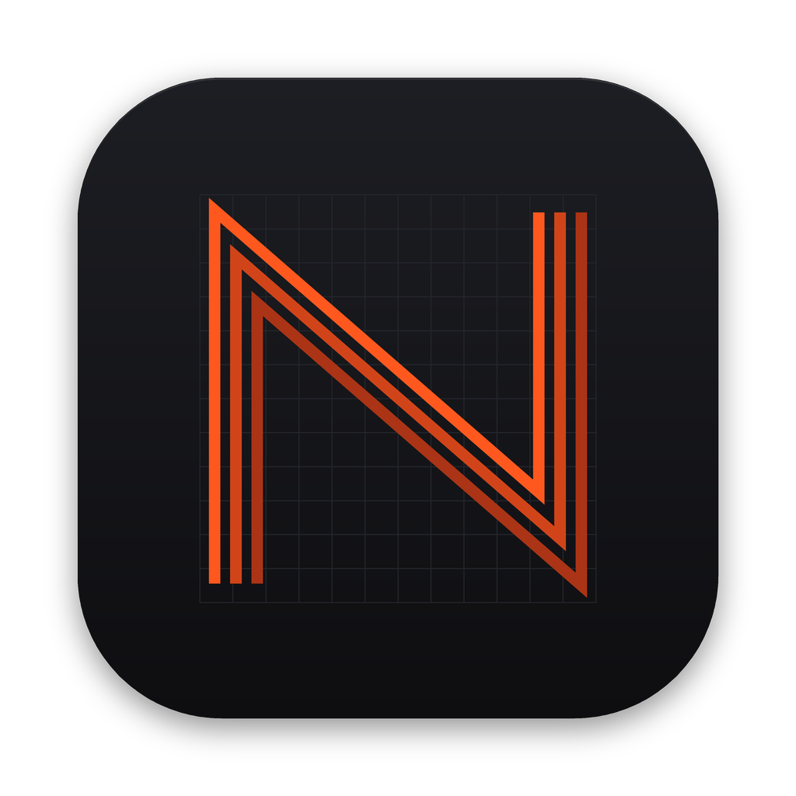

<div align="center">



# Neon

**A fast, native Markdown editor and live preview for macOS.**

[](https://github.com/michaelmjhhhh/neon/releases/latest)
[](#install)
[](#install)
<br>
[](rust-toolchain.toml)
[](https://github.com/zed-industries/zed/tree/main/crates/gpui)
[](#performance)
[](Cargo.toml)

</div>

---

Neon is a Markdown editor built on [GPUI](https://github.com/zed-industries/zed/tree/main/crates/gpui), the GPU-accelerated UI framework behind the Zed editor. It renders with Metal, parses off the main thread, and stays responsive in files tens of thousands of lines long.

## Features

- **Editor** with Markdown syntax highlighting.
- **Slash commands**: type `/` on an empty line to insert a list, task list, code block, link, image or table. `/table 4x5` sets the columns and rows; `/bullet 5` sets the number of items.
- **Live preview**: headings, emphasis, links, task lists, nested and numbered lists, block quotes, code blocks, tables with column alignment, images, footnotes and YAML front matter.
- **Three layouts**: Editor, Split and Preview. In Split, the preview follows the cursor.
- **Folder sidebar** to browse nested Markdown files, create new ones and refresh the tree.
- **Settings**: separate fonts and sizes for the editor and the preview, in light and dark mode.
- **Light and dark appearance**: follow the system, or pick Light or Dark in Settings.
- **Status bar** with cursor position, word count and how much of the file is in view. Builds with `--features diagnostics` also show FPS.

## Install

1. Download `Neon-<version>-macos.dmg` from the [latest release](https://github.com/michaelmjhhhh/neon/releases/latest).
2. Open it and drag **Neon** to Applications.

Neon runs natively on Apple Silicon and Intel Macs, macOS 11 or later. It is not signed with an Apple Developer ID yet, so macOS blocks the first launch: try to open Neon once, then go to **System Settings → Privacy & Security** and click **Open Anyway**.

## Keyboard shortcuts

| Action | Shortcut |
| --- | --- |
| New file | <kbd>⌘</kbd> <kbd>N</kbd> |
| Open file | <kbd>⌘</kbd> <kbd>O</kbd> |
| Open folder | <kbd>⌘</kbd> <kbd>⇧</kbd> <kbd>O</kbd> |
| Save / Save As | <kbd>⌘</kbd> <kbd>S</kbd> / <kbd>⌘</kbd> <kbd>⇧</kbd> <kbd>S</kbd> |
| Editor / Split / Preview | <kbd>⌘</kbd> <kbd>1</kbd> / <kbd>⌘</kbd> <kbd>2</kbd> / <kbd>⌘</kbd> <kbd>3</kbd> |
| Toggle sidebar | <kbd>⌘</kbd> <kbd>B</kbd> |
| Settings | <kbd>⌘</kbd> <kbd>,</kbd> |
| Close window | <kbd>⌘</kbd> <kbd>W</kbd> |

In the preview, <kbd>Space</kbd> and <kbd>⇧</kbd> <kbd>Space</kbd> page down and up, and <kbd>⌘</kbd> <kbd>↑</kbd> / <kbd>⌘</kbd> <kbd>↓</kbd> jump to the top and bottom.

## Performance

Typing is tuned for latency. Each keystroke is drawn and submitted as soon as it is handled, instead of waiting for the next display refresh. Syntax highlighting reparses in the background, and only the editor redraws while you type.

Measured in an 8,600-line document on a 60 Hz display:

| | Mean | p99 |
| --- | ---: | ---: |
| Keystroke → frame submitted | 1.6 ms | 5.2 ms |
| Keystroke → first refresh it can appear on | 10.5 ms | 17.9 ms |

To reproduce, run the in-app benchmark. It types into a generated document and writes JSON reports to `output/latency/`:

```sh
script/latency-bench my-run 3
```

Keep the Neon window in front while it runs; the benchmark pauses while another window is focused.

To compare memory use across startup, editing, images and document release, see
the [memory benchmark](docs/memory-benchmark.md). It records physical footprint,
live heap and lifetime peak memory across repeated runs.

## Build from source

Requirements: macOS, Xcode with the Metal toolchain, and [rustup](https://rustup.rs). The Rust version is pinned in `rust-toolchain.toml` and installed automatically.

```sh
cargo run --release              # build and launch
cargo test --workspace           # run the tests
script/bundle-mac --native       # package dist/Neon.app, .dmg and .zip for this Mac
script/bundle-mac                # universal binary for Apple Silicon and Intel
```

If the build cannot find the Metal compiler, install it with `xcodebuild -downloadComponent MetalToolchain`.

## Project layout

| Crate | Purpose |
| --- | --- |
| `crates/neon` | App entry point, menus and windows |
| `crates/workspace` | Document window: editor, sidebar, status bar, file handling |
| `crates/markdown_preview` | Virtualized, incrementally updated preview |
| `crates/markdown` | Markdown parsing into blocks, with source ranges |

Release notes live in [CHANGELOG.md](CHANGELOG.md).

## License

Apache-2.0.
